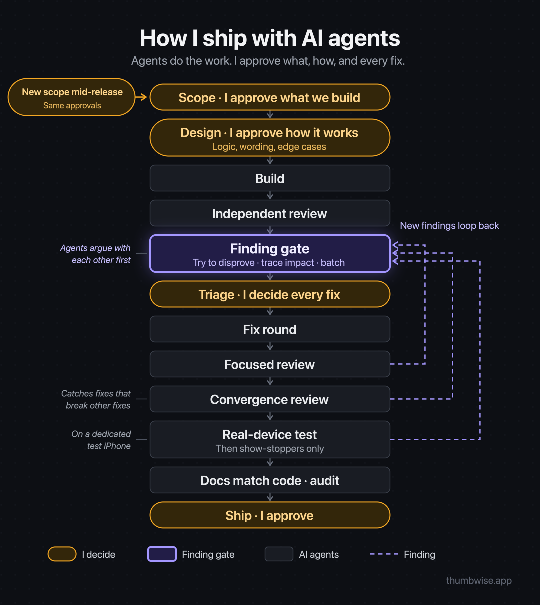
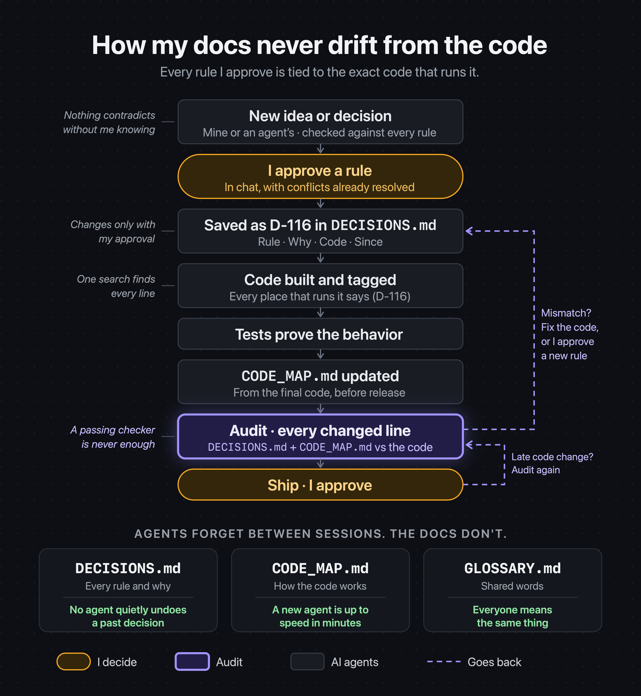

# agent-built

**Build serious consumer software with AI agents at full speed, with every decision still going through you.**

Agents forget everything between sessions and are often confidently wrong. So this process runs on checks and balances:

- **You talk to one PM agent.** It runs the process for you: scopes each version, briefs the agents doing the work, checks their results, and brings you only your decisions.
- **One small version at a time.** Each release has a short, frozen list of what matters most. New ideas wait for the next one, so every version actually finishes.
- **Every decision is checked.** Yours or an agent's, it's checked against every earlier decision and traced for side effects. Conflicts come to you.
- **Every finding is challenged.** A second agent tries to disprove it. Only what survives reaches you, batched, with a recommendation.
- **Every claim is proven.** Tested on the real thing, or labeled as unverified.
- **Agents get only what they need.** A tight brief, pointers instead of history, the right model for the job. Less noise, fewer mistakes, lower cost.
- **Nothing ships without you.** You approve what's built, how it works, every fix and every release.

You make every call, but only see what needs you.

From building [Thumbwise](https://thumbwise.app/?ref=github), a paid Mac app shipped this way.

## Getting started

1. Copy `templates/CLAUDE.md` to your project root and fill in the parts in angle brackets.
2. Copy the other files in `templates/` into `docs/`, and `process/release-process.md` to `docs/RELEASE_PROCESS.md`.
3. Copy the folders in `skills/` into `.claude/skills/`.
4. Open a Claude Code session in your project and tell it: *"You're the PM. Follow CLAUDE.md and docs/RELEASE_PROCESS.md."*
5. Tell the PM what you want in your first version. It takes it from there and comes back to you for decisions.

The templates are ready to use as they are. To see what filled-in entries look like, see [`examples/`](examples/).

## Contents

- **Process:** [Release process](#release-process)
- **Docs:** [CLAUDE.md](#claudemd) · [DECISIONS.md](#decisionsmd) · [CODE_MAP.md](#code_mapmd) · [GLOSSARY.md](#glossarymd) · [LEDGER.md](#ledgermd) · [BACKLOG.md](#backlogmd)
- **Skills:** [Start a Lead](#start-a-lead) · [Docs audit](#docs-audit)

---

# Process

## Release process

[`process/release-process.md`](process/release-process.md)

**What:** the steps every version goes through: scope, design, build, independent review, the finding gate, triage, fix rounds, a real-world test, a docs audit and release, with a gate at each step and clear rules for when to stop.

**Why:** agents are fast but overconfident. This puts every finding through a second agent that tries to disprove it, brings you only real decisions in one batch, and stops reviews from widening the scope forever.

# Docs

## CLAUDE.md

[`templates/CLAUDE.md`](templates/CLAUDE.md)

**What:** the instructions file every agent reads first: the sources of truth and their order, evidence rules, engineering principles, who does what (PM, Lead, Workers), which model to use for what, and how to brief a Worker. Using a tool other than Claude Code? Rename it `AGENTS.md`.

**Why:** every agent session starts from zero. This gives each one the same rules and habits in the first minute, so you're not re-explaining how you work every time.

## DECISIONS.md

[`templates/DECISIONS.md`](templates/DECISIONS.md)

**What:** every rule you've approved, each with an ID, the reason in your own words, and the exact code that implements it. That code carries the ID in a one-line comment, so one search finds the rule, its reason and all its code.

**Why:** it's the project's memory. New ideas are checked against it before they're built, so no agent quietly undoes or contradicts a past decision, and six months from now you still know *why* something works the way it does.

## CODE_MAP.md

[`templates/CODE_MAP.md`](templates/CODE_MAP.md)

**What:** how the code works, one section per subsystem: what it does, the flow step by step, key files, what must always hold, and where to start debugging from a given error.

**Why:** a new agent session is up to speed in minutes instead of rediscovering the codebase. It's updated from the final code at every release and audited line by line, so it can't go stale.

## GLOSSARY.md

[`templates/GLOSSARY.md`](templates/GLOSSARY.md)

**What:** the shared words for your product and process, one line each, with the code name when it differs.

**Why:** when you, your agents, your docs and your user-facing text all use the same words, instructions aren't misread and users see consistent language.

## LEDGER.md

[`templates/LEDGER.md`](templates/LEDGER.md)

**What:** the open list of fixes and the current version's scope. Every item has an ID and a "done means" line, and it leaves only when it's fixed in a released version or you drop it.

**Why:** nothing found in a review or test gets lost, and nothing sneaks into a release unplanned. Ideas go to a separate backlog, so the ledger stays a list of things that must be done.

## BACKLOG.md

[`templates/BACKLOG.md`](templates/BACKLOG.md)

**What:** future ideas you've explicitly approved keeping, each with a status, the date you approved it, the direction you chose and its open questions.

**Why:** agents suggest a lot, and good ideas mentioned in passing get lost. The backlog keeps only what you approved, and makes clear it's not a promise or permission to build, so ideas never creep into a release on their own.

# Skills

## Start a Lead

[`skills/start-lead/SKILL.md`](skills/start-lead/SKILL.md)

**What:** the Claude Code skill the PM uses to start an implementation agent (a "Lead") for a version: numbering, pre-start checks, the brief template, adding items mid-version, and checking the Lead's report.

**Why:** a good brief is most of what makes an agent reliable. This one gives the Lead the goal, the exact scope, its gates and limits, and how findings are handled, so it doesn't rediscover strategy or quietly widen the scope.

## Docs audit

[`skills/docs-audit/SKILL.md`](skills/docs-audit/SKILL.md) · [`check_docs.py`](skills/docs-audit/check_docs.py)

**What:** the release-time audit of `DECISIONS.md` and `CODE_MAP.md` against the final code, plus a checker script. The script confirms every path and code name the docs cite exists, every decision ID is accounted for, every ID tagged in the code is an active decision, and the ledger's next-free-ID line is right. Set your folders in its CONFIG block.

**Why:** docs that drift from the code are worse than no docs, because agents trust them. The script catches the mechanical drift in seconds; the line-by-line review catches what a script can't see, so the docs you approve a release on are accurate.

---

MIT licensed. Copy it, adapt it, make it yours.
