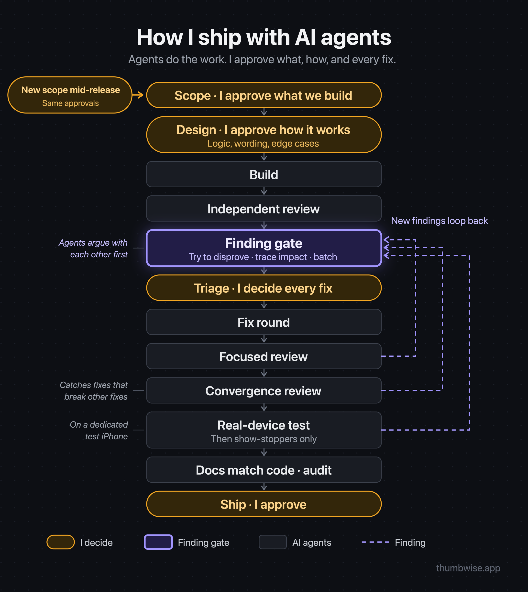

# Release process

How every version is scoped, built, reviewed, tested and shipped when AI agents do the work and one person makes the decisions. It keeps each release small, correct and finished, without review loops that keep widening scope.

## Roles

- **Owner** (you): approves scope, how things work, every fix and every release. Only the owner can widen a frozen scope.
- **PM**: an agent session that runs this process for the owner. It writes briefs, keeps the ledger, checks every claim against the docs and the code before reporting it, and brings the owner only what needs them.
- **Lead**: an agent session that implements one version in one checkout, with tests, and reports evidence.
- **Reviewers**: independent agents that only report findings. They never edit code.

## Steps and gates

1. **Scope.** The owner approves a short list of items, each with a "done means" line. The PM records it under "Current version" in the ledger. Every item goes through the scoping rule below. *Gate:* the scope grows only when the owner explicitly adds an item. Other ideas wait in the backlog.
2. **Design.** For each item, the PM brings the owner how it will work before it's built: the logic, what users see and read, and the edge cases, each with a recommendation. Anything an existing decision already settles is followed, not asked. *Gate:* the owner has approved how each item works.
3. **Build.** The Lead implements the scoped items, one writer per checkout. Each item ships with tests for its observable behavior. If the build raises a choice the Design step didn't settle (what users see, how a flow behaves), the Lead first checks the decisions, the glossary and the item's done-means, and follows whatever already decides it. Only a choice nothing there clearly answers goes to the owner, through the PM, with a recommendation, before it's built. Internal engineering choices stay with the Lead. *Gate:* every item is done.
4. **Review.** One independent reviewer examines the version's diff against the scope, the decisions and owner-confirmed facts. It also flags any changed rule without a decision entry and code tag. Its findings pass the finding gate. *Gate:* every surviving finding is in the ledger.
5. **Triage.** The PM sorts each finding with the triage rule and brings the owner the fix-now list with reasons, plus one line for each finding to defer or reject. The owner confirms the list and can pull any deferred finding in. *Gate:* the fix list is approved.
6. **Fix round.** The Lead fixes the approved list with tests. A focused review then checks only those fixes. Its findings pass the finding gate and go through triage; they are never fixed automatically. Scope added mid-version goes through the scoping rule and gets the same focused review. *Gate:* the fixes are verified.
7. **Convergence review.** When a version had more than one fix round or mid-version scope, one fresh reviewer examines everything changed since the first review, looking for fixes that break other fixes. Its findings pass the finding gate. *Gate:* no surviving finding is left untriaged.
8. **Real-world test.** The Lead runs a fixed checklist on the real thing (a device, a staging environment, a release build), plus checks for what this version touched. The owner does only what needs their hands or eyes. *Gate:* the checklist passes. **After this step, only show-stoppers are fixed** (a false or harmful result, data loss, or a blocked core flow). Everything else waits.
9. **Record.** The docs are made to match the final code (see `templates/` and the docs diagram):
   - The Lead finalizes every decision entry the version touched, tags every implementing place with its decision ID (never deferred), and updates the code map for every subsystem it touched.
   - **An owner's approval in chat is the decision.** The PM writes the entry when the owner approves. It comes back to the owner only if the final code changes what was approved or it conflicts with another decision.
   - **The PM audits every changed line** of both docs against the release commit: each rule matches the code, every path and symbol exists, nothing remains from a dropped direction, no working notes. A passing checker is never enough; it can't see missing content.
   - **Any code change after Record reopens it.**
   - *Gate:* the audit is clean.
10. **Release.** The PM brings the exact release notes and the go-ahead request in one message; the owner approves both. The release commit gets a tag. Afterwards the PM cleans the ledger: deferred findings move to the open list, fixed items and the version's scope are removed.

## Scoping rule

Applies to every item before it enters a version, at the start or mid-version. The goal is robustness, simplicity and fewer errors users can run into. The PM does this itself:

1. **Trace** how it works today (code and decisions) and what users actually run into.
2. **Weigh it:** how often it happens against the risk and size of the change. "Don't do it" is a valid recommendation.
3. **Find the smallest change,** preferring an existing flow over new logic or special cases.
4. **List what else it affects:** other flows, saved data, other decisions, anything that would become inconsistent.
5. **Keep familiar patterns** users already know; a new kind of flow only if the owner chooses it.
6. **Bring the owner only what needs them,** short first, each with a recommendation. If nothing needs the owner, say so in one line.

## Finding gate

Every finding, whatever found it (review, audit, test, an agent's own check), passes this gate before it reaches the owner:

1. **Disprove.** A second agent that didn't raise it tries to prove it wrong: confirmed, partly, or refuted, with reachability (normal use, safety net, never).
2. **Implications.** For each survivor: what else it affects and the smallest fix.
3. **One list per round.** The owner sees only survivors, batched, each with a recommendation, so they decide once per round and never approve something a later check would reject.

## Triage rule

Fix a finding in the current version only if:

- the current version's changes caused it, or
- users can hit it in the live version, and it is false, harmful or blocks a core flow.

Everything else is deferred to the ledger, or rejected with a reason.

## Evidence rules

- Every finding cites file and line, and the steps from cause to result.
- Every claim is labeled **VERIFIED** (shown by a test, harness or real run) or **TRACED** (code reading only). Open questions are listed separately.
- The PM checks agents' claims before passing them on. A real run outranks code reading.

## Stopping rules

- One review per version, a focused review of each fix round, and at most one convergence review. No open-ended re-reviews.
- After the real-world test, only show-stoppers are fixed.
- A finding outside the frozen scope never widens it. It goes to the ledger.

## Hotfixes

An urgent bug in the live version gets its own minimal release with the same review, test and release steps, scoped to that bug only. It never widens a version already in progress.
